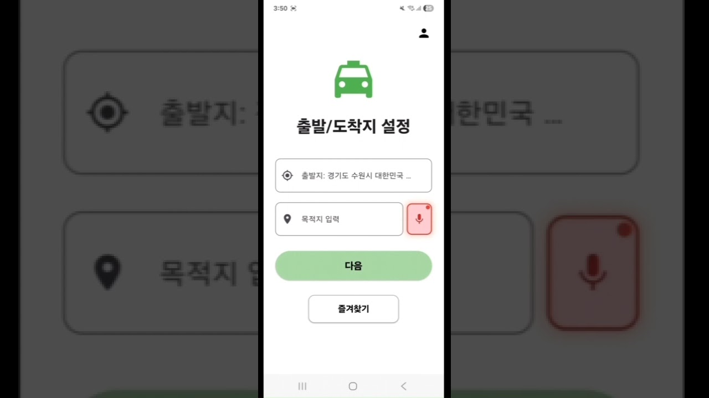
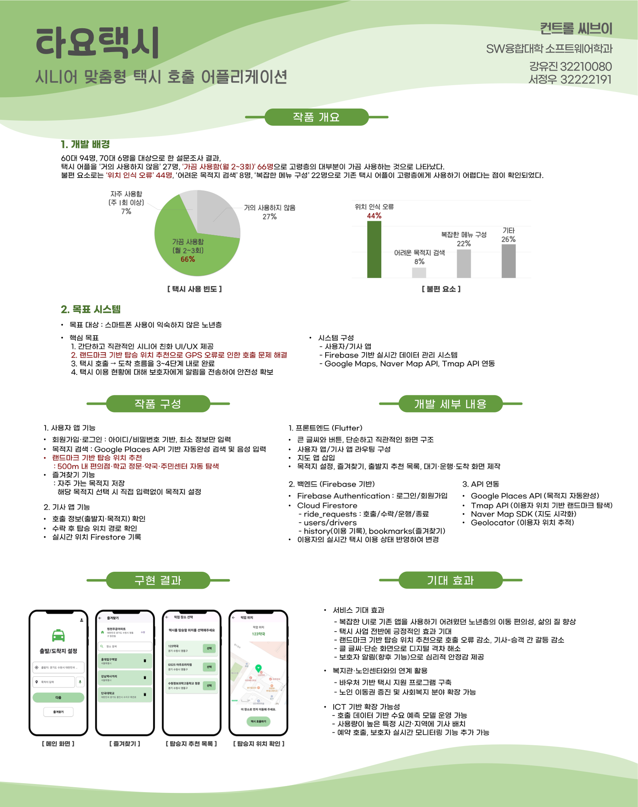
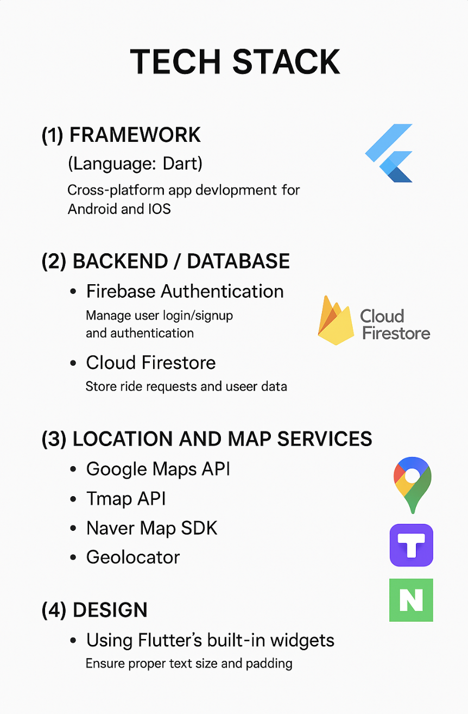
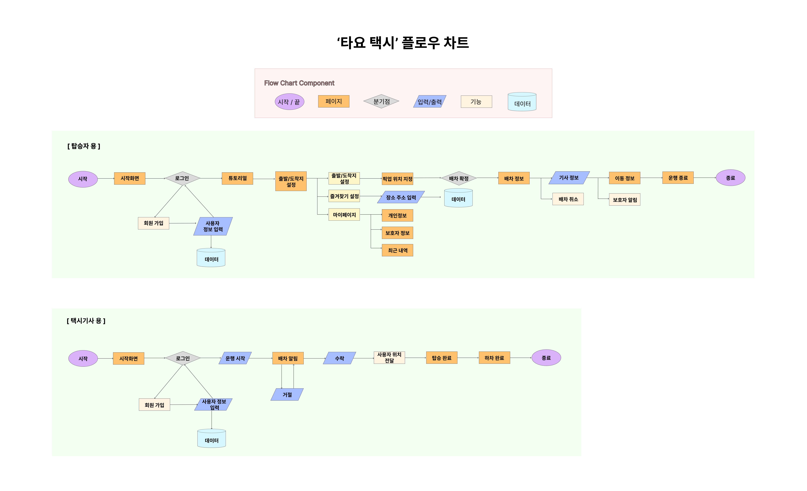

# 타요택시 (Tayo Taxi)

시니어 맞춤형 택시 호출 앱 · Flutter · Firebase

기사 앱: [tayo-taxi-driver](https://github.com/cloudbread0714/tayo-taxi-driver)

---

## 시연 영상

  

  <a href="https://www.youtube.com/shorts/5BCnoYH2l_A">▶ YouTube에서 재생</a>

---

## 포스터

  

  <a href="docs/poster.pdf">포스터 PDF 보기</a>
  &nbsp;·&nbsp;
  <a href="docs/final-report.pdf">결과보고서 PDF</a>

---

## 주요 기능

- 현재 위치 자동 추적 기능
- 현재 위치 기반 500m 이내 랜드마크 리스트 제공 후 픽업 위치 선정
- 즐겨찾기 기능
- Firebase 연동을 통한 인증 및 실시간 데이터 처리

## 기술 스택

  

| 구분 | 기술 / API | 설명 |
|------|------------|------|
| **프레임워크** | Flutter (Dart) | UI 구현 및 크로스 플랫폼 앱 개발 |
| **백엔드 / DB** | Firebase Authentication | 사용자 인증 처리 |
| | Cloud Firestore | 실시간 데이터베이스 연동 |
| **위치 / 지도 API** | Google Maps API | 목적지 자동완성, 위도·경도 변환 |
| | Tmap API | 500m 이내 약국, 편의점, 주민센터, 학교 정문 등 픽업 위치 리스트 |
| | Naver Map SDK | 픽업 위치 지도 시각화 |
| | Geolocator | 현재 위치 조회 |

## 플로우 차트

  

## 개발 팀원

| 이름 | 역할 | 주요 담당 업무 |
|------|------|----------------|
| 서정우 | 팀장 / 프론트엔드 | 전체 UI 디자인 및 화면 레이아웃, 즐겨찾기·이용 내역, 보고서 |
| 강유진 | 팀원 / 백엔드 | API 및 DB 연동, 로그인/회원가입, 랜드마크 기반 위치 탐색, 보고서 |
